# Local AI coding

If you are using copilot and you want to try the local coding agent, you just need to install one program and you can also use local ai. Local coding agent has the advantage that your source code is not transferred into the cloud. If you work in a company they might demand this from you.

## Lets install unsloth Desktop

Install Unsloth desktop. It has the advantage to also update the ai tools all the time (which is needed when new models come up). Run the installer from:

https://unsloth.ai/docs/get-started/install/

Use default recommended settings.

Then start the program and first select a model:

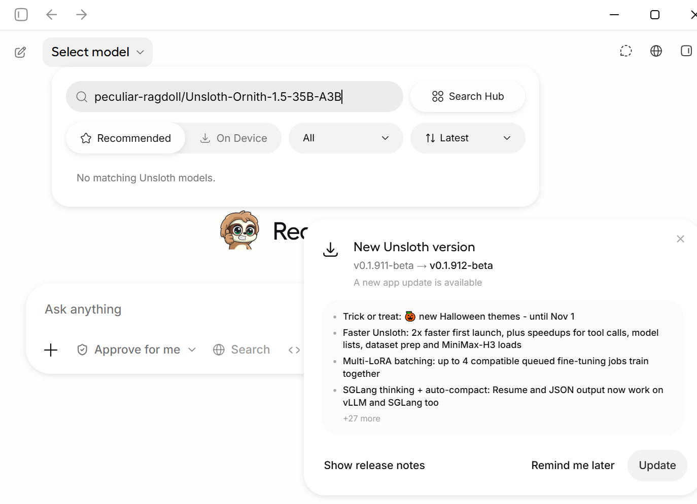

If you have only 8GB GPU or even only CPU (at least 32GB ram) then you ``peculiar-ragdoll/Unsloth-Ornith-1.5-35B-A3B`` is a good model and unsloth desktop uses internally llama.cpp that is able to offload to cpu if not the whole model fits into GPU RAM. Also Ornith is a mixture of expert model such that only needed experts can be loaded into GPU which makes it possible to run it quite efficiently on your laptop.

click on search the hub

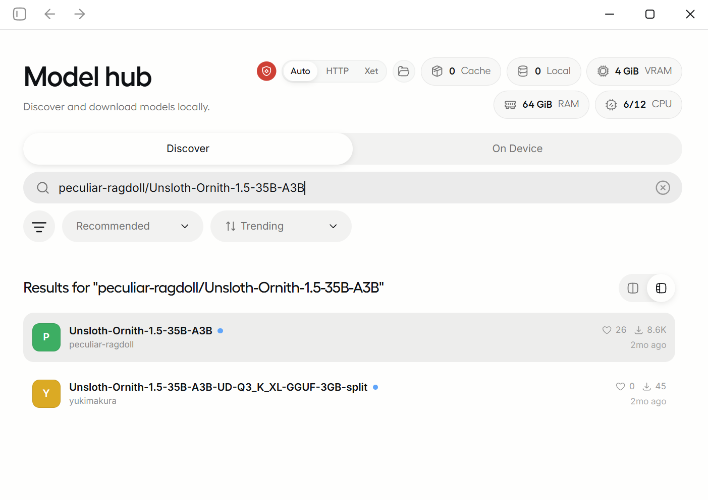

for small 8GB GPU or even only pc (at least 32GB RAM if only CPU).

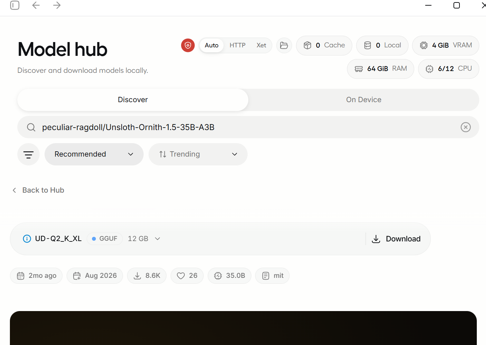

then run the model. 

later select it:

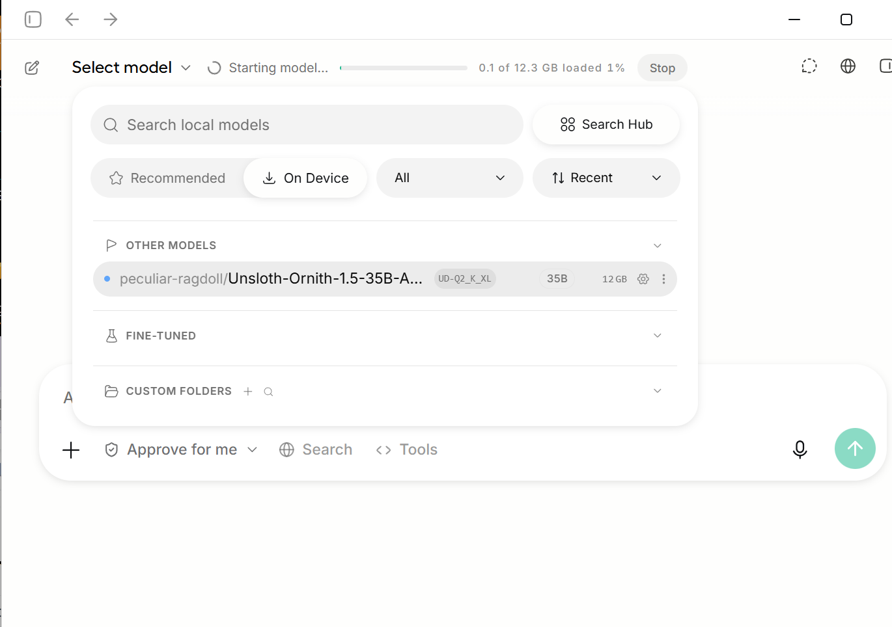

if needed you can increase context by hovering over the cog wheel:

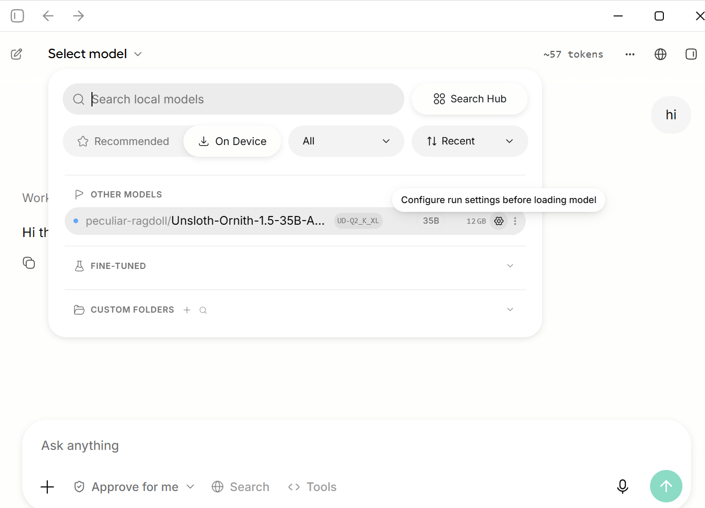

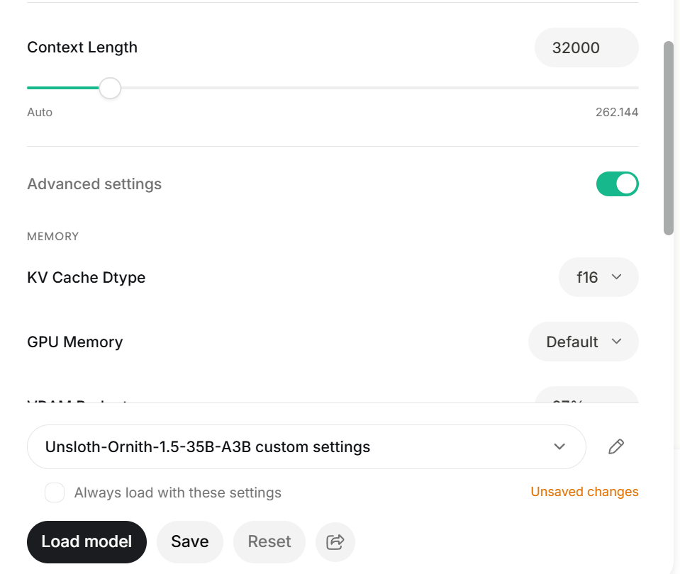

in command line

```
unsloth start vscode
```

## Try AI

Now you can use the model inside vs-code to chat.

click on the copilot symbol then select local:

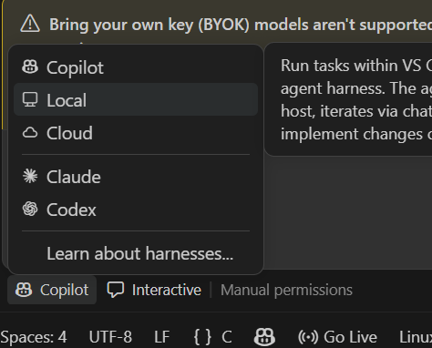

Then click on the two stars to select Unsloth managed models:

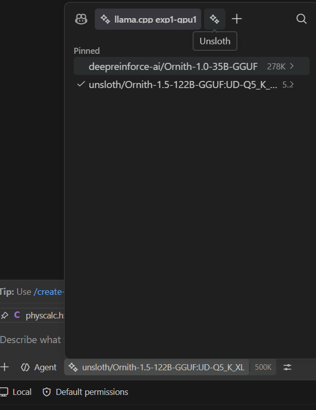


To open the chat window you can do the following press CTRL+ALT+I then type 

```
please explain me this codebase @Codebase

how does this file work @filename

```

and click on file.

you can also mark a text and press CTRL+I for inline chat and say for example: ``make comments``.

Lets make a different thing how about a fibonacci [$f(0)=0, f(1)=1,f(n)=f(n-1)+f(n-2)$] number calculator.

lets make life a bit hard for ai by starting with something completely corrupted:
```html
<!doctype html>
<html>
  <head>
    <title>My recipie page</title>
    <scipt>
      //fibonacci function returning n-th fibonacci

  <H1>Recipies</H1>
console.log('Hello');
  <H2>Pancakes</H2>
<p>Ingredients</p>
<ul>
  
</ul>
  <!-- add input field -->
  <input type="number" id="portionInput" name="portionInput">
  <script>
    // Add script to recalculate amounts
    const input = document.getElementById('portionInput');
    input.addEventListener('input', function() {
      // Recalculate amount based on input value
    });
  </script>
</body>
</html>
```
and just put your cursor where the fibonacci function is and try to press tab to get the results.

Then use the life server extension to see the result. It does not work.

Ask the ai chat to correct it itteratively.

Next we will use an ai coding agent that can even generate complete projects.

## Using other AI Agents (Harness) such as Claude Code

If you want to use other AI agents such as claude code you for example type in the command line ``unsloth start claude`` . But more convenient is the use of an AI proxy that also allows you to connect your laptop to the unsloth that you installed on a powerful gaming pc. The proxy cares about setting the right configuration entries and allows you to use a huge range of AI Agents.

Here is the link to FREE-CLAUDE-CODE (the name is misleading as it allows you to install a huge range of AI agents): https://github.com/alishahryar1/free-claude-code#1-install

The installation is exemplified for windows but for other sytems the web pages provides full details.

For windows open powershell (win-r):

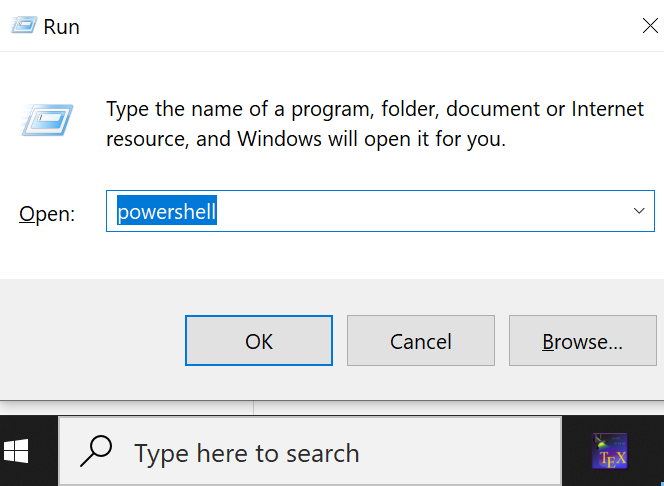

then type

```
& ([scriptblock]::Create((irm "https://raw.githubusercontent.com/Alishahryar1/free-claude-code/main/scripts/install.ps1")))
```

and say y or n(or enter) to the things you want to install.

and say yes to RTK+Headroom token optimization

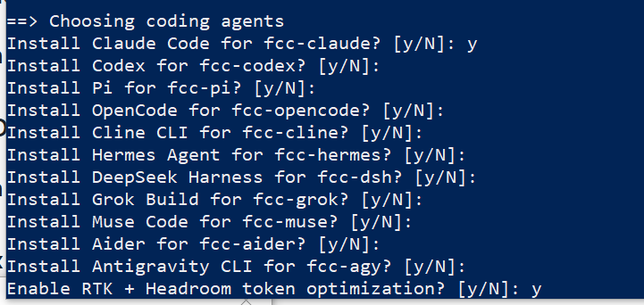

Now run fcc

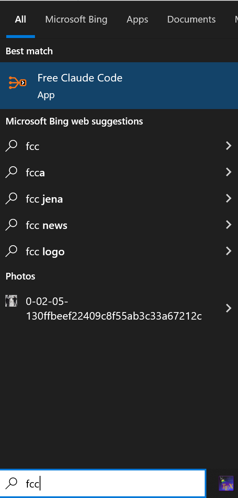

The admin panel opens. First you need to configure your custom provider (either local unsloth) or remote (if you run unsloth remote you need click ``Add provider`` in the Providers tab:

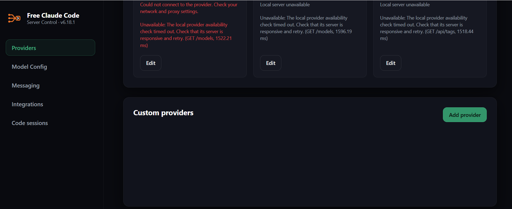

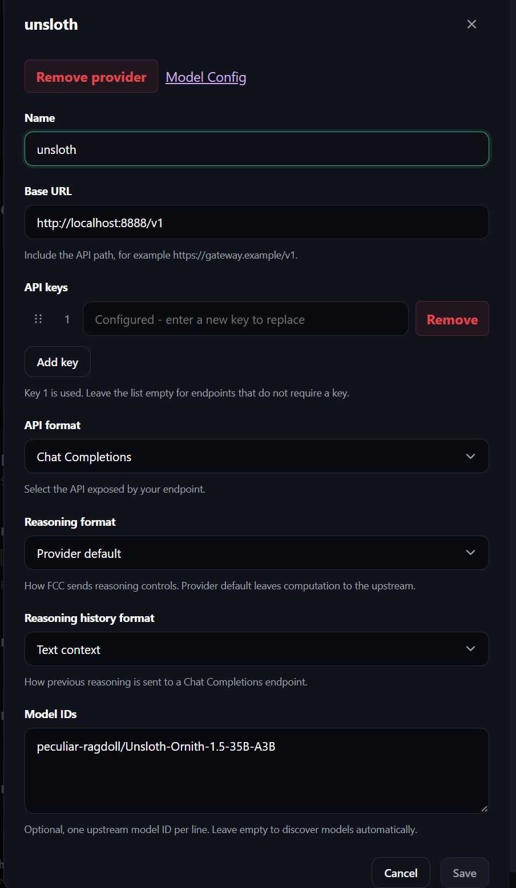

Then in the model config tab: erase the default model.

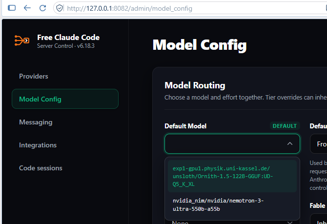

select your custom provider and click on accept

Then in integration, then activate vs-code copilot and after installing claude code extension in vs-code click vs-code claude and vs-code claude onboarding.

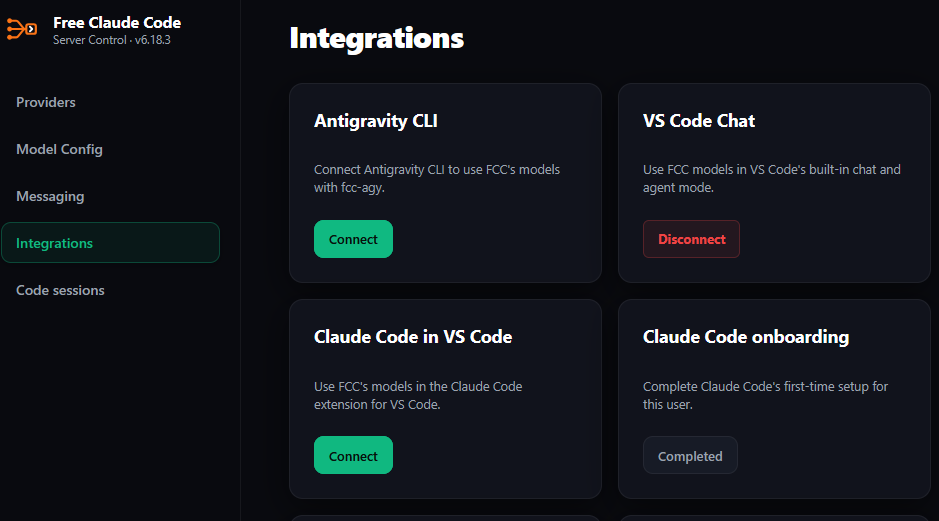

In vs-code you can select the star symbol to select the Free-Claude- Code managed models:

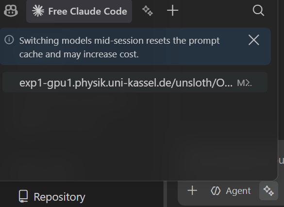

But you can also now use claude code in vs-code:

by selecting the red star:

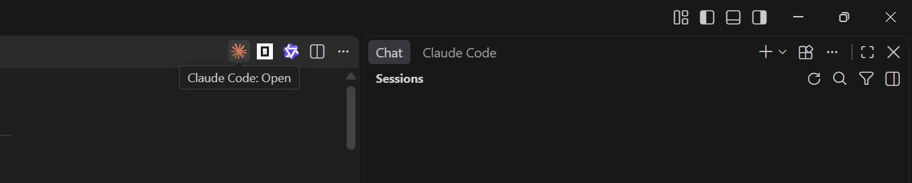

if you want to run it from command line you can run:

```
fcc-claude
```

